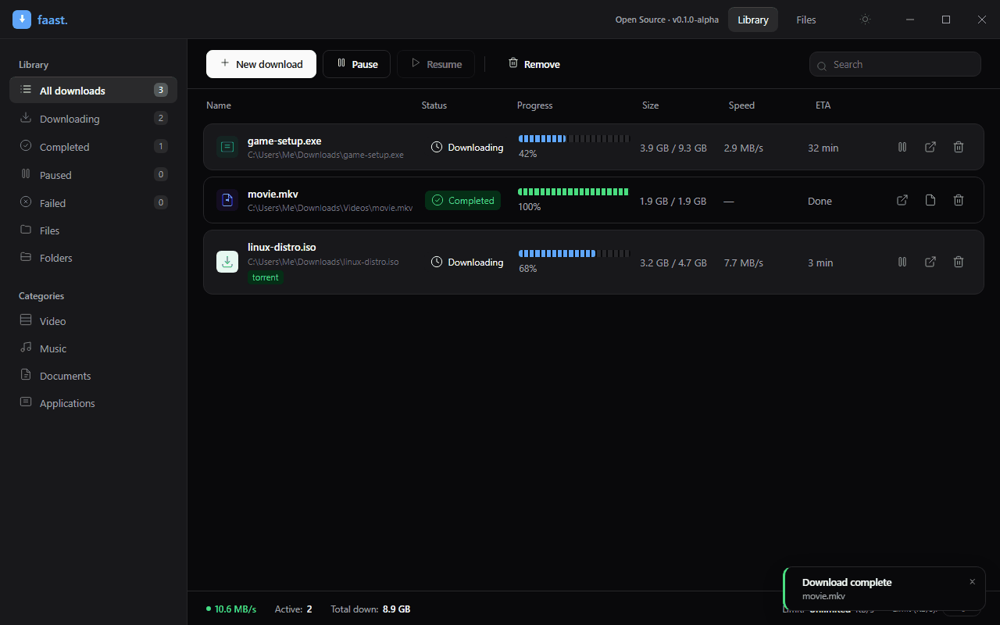
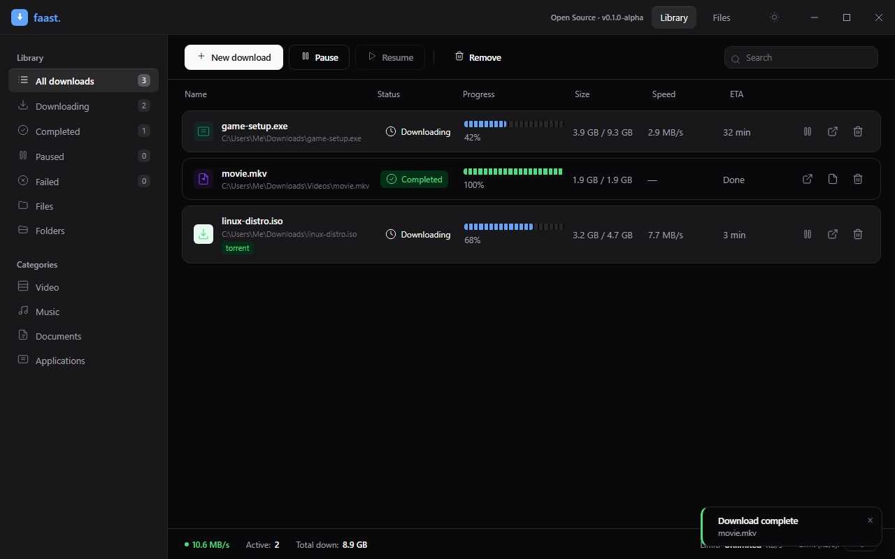

# Faast

**A free, open-source download manager for Windows that keeps working when the link gets difficult.**

Faast is a local-first desktop app: segmented HTTP downloads, full BitTorrent support, and yt-dlp routing in one small native window. No account, no ads, no telemetry, no browser extension that can silently disconnect.

> [!NOTE]
> **Early alpha (v0.1.0).** Windows only. See [Limitations](#limitations) before you switch from IDM or FDM.





## Why Faast

Most download managers fail in the same few ways: an extension stops talking to the app, a paused transfer won't resume, a failed download shows a stuck bar with no explanation. Faast is built around the opposite priority — **the transfer is the product**. It splits large files across parallel Range connections, writes each part to disk as it arrives, resumes from exactly where it stopped, and tells you plainly when something goes wrong.

It is an independent implementation inspired by [Free Download Manager](https://www.freedownloadmanager.org/), not a fork.

## Quick start

**Install (Windows 10/11, x64):** download `Faast_0.1.0_x64-setup.exe` (NSIS) or the MSI from the [Releases](https://github.com/faast/faast/releases) page and run it. The repo URL in this README is a placeholder until the project goes public.

```powershell
# from source
git clone <your-repo-url> faast
cd faast
npm install
npm run tauri build
```

Then paste an HTTP(S) link, a `magnet:` URI, or a `.torrent` path into **New download**. Dropping a `.torrent` file anywhere on the window also works.

## What it does

- **Segmented HTTP** — 8–32 parallel Range connections by file size, with a single-stream fallback for servers that don't support ranges. Part files are resumable after a crash or pause.
- **Torrents and magnets** — `librqbit` engine with DHT, UDP/HTTP trackers, web seeds, TCP + uTP, PEX, UPnP port forwarding and a 500-peer limit.
- **Video and audio links** — yt-dlp routing with format selection (1080p/720p/480p, MP3/M4A/WAV/FLAC/Opus).
- **Queue control** — pause, resume, retry, remove, filter by status or category, search, schedule a start time.
- **Folder routing** — rules by extension or keyword send finished files into subfolders.
- **Bandwidth control** — global speed limit in KB/s.
- **A quiet interface** — shadcn-style dark shell, segmented progress bars, live status bar, toast feedback, edge-to-edge native window.

## Benchmarks

On a local Range-capable server with a 128 MiB payload, the engine's own helpers measure:

| Connections | Time | Throughput |
|---:|---:|---:|
| 1 | 1.058 s | 121 MB/s |
| 8 | 0.259 s | 495 MB/s |
| 16 | 0.231 s | 553 MB/s |
| 32 | 0.261 s | 491 MB/s |

That is a **4.6× speedup** from segmentation on loopback. We publish the method and the caveats in [docs/BENCHMARKS.md](docs/BENCHMARKS.md) — including that 32 connections is *worse* locally and exists for CDNs that cap each connection. We do not claim a "10× faster" headline.

## Limitations

Honestly, today:

- **Windows only.** No macOS or Linux build yet.
- **No browser extension.** Downloads are added by pasting a link or dropping a `.torrent`. Browser interception is planned, not shipped.
- **Global speed limit applies to yt-dlp downloads.** HTTP and torrent bandwidth caps are not enforced yet.
- **No per-torrent file priorities**, no RSS/automation, no remote web UI.
- **Installer is unsigned** until a code-signing certificate is configured.

If any of those is a deal-breaker, [AB Download Manager](https://github.com/amir1376/ab-download-manager) or [FDM](https://www.freedownloadmanager.org/) may serve you better right now.

## Tech stack

- **Shell:** Tauri v2, Rust backend, system WebView2
- **Frontend:** Vite + vanilla JavaScript, no framework
- **Engine:** `reqwest` (segmented HTTP), `librqbit` 9.1.0 (BitTorrent), `yt-dlp` (media)

## Development

```bash
npm run dev            # Vite dev server on :1420
npm run build          # production frontend into dist/
npm run e2e            # 62 Playwright UI checks (needs vite preview on :4173)
cd src-tauri && cargo test --lib
```

Additional test layers and the local benchmark are documented in [docs/TESTING.md](docs/TESTING.md) and [docs/BENCHMARKS.md](docs/BENCHMARKS.md).

Install packaging (winget/Scoop manifests, signing) is in [docs/INSTALL.md](docs/INSTALL.md). Product direction is in [docs/POSITIONING.md](docs/POSITIONING.md).

## License

MIT — see [LICENSE](LICENSE).
